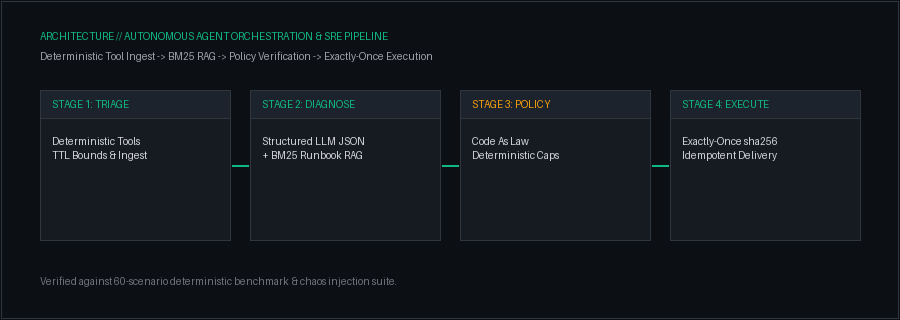

<div align="center">

<!-- 01: CINEMATIC DYNAMIC RESEARCH LAB HERO BANNER (ANIMATED SPACEX EARTH & CONSTELLATION) -->
<a href="https://github.com/anshu-ai-arch">
  
</a>

<br/><br/>

<!-- Real-Time Terminal Status -->
<a href="https://github.com/anshu-ai-arch">
  
</a>

<br/>

<!-- Connected Social Navigation Bar (Flat Dark Badges) -->
<p align="center">
  <a href="https://www.linkedin.com/in/anshu-tiwari-69b3b1327" target="_blank">
    
  </a>
  &nbsp;&nbsp;
  <a href="https://x.com/Anshutiwarai" target="_blank">
    
  </a>
  &nbsp;&nbsp;
  <a href="https://substack.com/@anshutiwari523410" target="_blank">
    
  </a>
  &nbsp;&nbsp;
  <a href="https://github.com/anshu-ai-arch?tab=repositories">
    
  </a>
</p>

</div>

<br/>

<!-- ========================================================================= -->
<!-- 02: IDENTITY & CORE RESEARCH PILLARS (LARGE COMMANDING TYPOGRAPHY)       -->
<!-- ========================================================================= -->

## 02 / IDENTITY &amp; CORE RESEARCH

<table>
  <tr>
    <td style="padding: 24px; background: #161B22; border: 1.5px solid #30363D; border-radius: 10px;">
      <h2 style="margin: 0 0 12px 0; color: #FAF5EE; font-size: 24px;">
        ANSHU TIWARI &mdash; <span style="color: #10B981;">AI Engineer &amp; Biomedical Researcher</span>
      </h2>
      <p style="font-size: 16px; line-height: 1.6; color: #E4E4E7; margin: 0 0 18px 0;">
        Specialized in bridging <b>physiological time-series deep learning</b> (cardiac telemetry &amp; multi-channel EEG neural decoding) with <b>production-grade autonomous AI systems</b> (deterministic incident triage, tool-augmented copilots, and high-throughput distributed infrastructure).
      </p>
      <hr style="border: 0; border-top: 1px solid #30363D; margin: 16px 0;" />
      <table width="100%" style="font-size: 15px; border: none;">
        <tr>
          <td width="33%" valign="top" style="border: none; padding-right: 14px;">
            <span style="color: #F59E0B; font-weight: bold; font-family: monospace; font-size: 12px;">01 // CLINICAL SIGNAL AI</span><br/>
            <b style="color: #FAF5EE; font-size: 16px;">ECG &amp; EEG Deep Learning</b><br/>
            <span style="color: #A1A1AA; font-size: 13.5px;">Automated epileptic seizure onset prediction, multi-lead cardiac telemetry, and morphological arrhythmia classification.</span>
          </td>
          <td width="33%" valign="top" style="border: none; padding-right: 14px;">
            <span style="color: #10B981; font-weight: bold; font-family: monospace; font-size: 12px;">02 // AUTONOMOUS SYSTEMS</span><br/>
            <b style="color: #FAF5EE; font-size: 16px;">Agent Swarms &amp; SRE</b><br/>
            <span style="color: #A1A1AA; font-size: 13.5px;">Deterministic tool orchestration, policy-as-code verification, exactly-once delivery, and BM25 runbook RAG copilots.</span>
          </td>
          <td width="33%" valign="top" style="border: none;">
            <span style="color: #38BDF8; font-weight: bold; font-family: monospace; font-size: 12px;">03 // MODEL INTERPRETABILITY</span><br/>
            <b style="color: #FAF5EE; font-size: 16px;">Explainable AI (XAI)</b><br/>
            <span style="color: #A1A1AA; font-size: 13.5px;">Transformer attention head probing, residual stream activations, SHAP saliency maps, and clinical validation.</span>
          </td>
        </tr>
      </table>
    </td>
  </tr>
</table>

<br/>

<!-- ========================================================================= -->
<!-- 03: BIOMEDICAL SIGNAL RESEARCH & TELEMETRY (LIVE DYNAMIC MONITORS)       -->
<!-- ========================================================================= -->

## 03 / BIOMEDICAL SIGNAL RESEARCH &amp; TELEMETRY

<table width="100%">
  <tr>
    <td width="50%" align="center" valign="top">
      <h3>ECG CARDIAC TELEMETRY // LIVE SIGNAL</h3>
      
      <p align="left">
        <b>Model:</b> 1D-CNN + BiLSTM &bull; <b>Lead:</b> Lead-II Diagnostic (500 Hz)<br/>
        <b>Focus:</b> Real-time P-QRS-T arrhythmia detection, heart-rate variability, and clinical telemetry.
      </p>
    </td>
    <td width="50%" align="center" valign="top">
      <h3>EEG NEURAL ACTIVITY // 8-CHANNEL SCOPE</h3>
      
      <p align="left">
        <b>Channels:</b> FP1, F3, C3, P3, O1, T3, FZ, CZ (256 Hz)<br/>
        <b>Focus:</b> Multi-channel rhythmic brainwave oscillations and highlighted focal seizure onset detection.
      </p>
    </td>
  </tr>
</table>

<p align="center">
  
</p>

<br/>

<!-- ========================================================================= -->
<!-- 04: AUTONOMOUS SYSTEMS & DISTRIBUTED CONSTELLATION                       -->
<!-- ========================================================================= -->

## 04 / AUTONOMOUS SYSTEMS &amp; DISTRIBUTED ARCHITECTURE

<p align="center">
  <h3>MOSIP DISTRIBUTED ARCHITECTURE // GLOBAL IDENTITY CONSTELLATION</h3>
  
</p>

<p align="center">
  
</p>

<br/>

<!-- ========================================================================= -->
<!-- 05: FEATURED TECHNICAL REPOSITORIES                                       -->
<!-- ========================================================================= -->

## 05 / FEATURED TECHNICAL REPOSITORIES

<table width="100%">
  <tr>
    <td width="50%" valign="top">
      <h3><a href="https://github.com/anshu-ai-arch/eeg_seizure_detection">eeg_seizure_detection</a></h3>
      <p style="font-size: 14px; color: #D4D4D8;">Deep learning models for automated epileptic seizure detection from continuous multi-channel biological EEG telemetry.</p>
      <code>Python</code> &bull; <code>EEG</code> &bull; <code>Deep Learning</code> &bull; <code>PyTorch</code>
    </td>
    <td width="50%" valign="top">
      <h3><a href="https://github.com/anshu-ai-arch/cornflakes-copilot-">cornflakes-copilot-</a></h3>
      <p style="font-size: 14px; color: #D4D4D8;">Autonomous SRE and incident triage copilot &mdash; deterministic tool execution, BM25 runbook RAG, chaos tests, exactly-once pipelines.</p>
      <code>AI Agents</code> &bull; <code>FastAPI</code> &bull; <code>PostgreSQL</code> &bull; <code>Docker</code>
    </td>
  </tr>
  <tr>
    <td width="50%" valign="top">
      <h3><a href="https://github.com/anshu-ai-arch/gpt2_interpretability_research">gpt2_interpretability_research</a></h3>
      <p style="font-size: 14px; color: #D4D4D8;">Mechanistic interpretability research on GPT-2 transformers &mdash; probing attention heads, residual streams, and neural activation paths.</p>
      <code>XAI</code> &bull; <code>Transformers</code> &bull; <code>PyTorch</code> &bull; <code>Interpretability</code>
    </td>
    <td width="50%" valign="top">
      <h3><a href="https://github.com/anshu-ai-arch/hostalgrid-plus-plus">hostalgrid-plus-plus</a></h3>
      <p style="font-size: 14px; color: #D4D4D8;">Computational resource allocation modeling and grid optimization algorithms for high-throughput computing.</p>
      <code>Optimization</code> &bull; <code>Algorithms</code> &bull; <code>Jupyter</code> &bull; <code>HPC</code>
    </td>
  </tr>
  <tr>
    <td width="50%" valign="top">
      <h3><a href="https://github.com/anshu-ai-arch/MOSIP1">MOSIP1</a></h3>
      <p style="font-size: 14px; color: #D4D4D8;">Scalable TypeScript integration for national-scale open digital identity architecture and modular services.</p>
      <code>TypeScript</code> &bull; <code>Distributed Systems</code> &bull; <code>Identity</code>
    </td>
    <td width="50%" valign="top">
      <h3><a href="https://github.com/anshu-ai-arch/razorops">razorops</a></h3>
      <p style="font-size: 14px; color: #D4D4D8;">Production-grade automated CI/CD pipeline infrastructure, containerized build environments, and delivery acceleration.</p>
      <code>CI/CD</code> &bull; <code>Docker</code> &bull; <code>DevOps</code> &bull; <code>Linux</code>
    </td>
  </tr>
</table>

<br/>

<!-- ========================================================================= -->
<!-- 06: PRODUCTION TOOLCHAIN & RESEARCH ARSENAL                               -->
<!-- ========================================================================= -->

## 06 / PRODUCTION TOOLCHAIN &amp; VERIFIED STACK

<div align="center">

```text
Research:    PyTorch · Transformers · NumPy · SciPy · Scikit-Learn · Explainable AI (SHAP / Attention)
Engineering: Python (Async) · Modern C++ (17/20) · TypeScript · FastAPI · Docker · PostgreSQL · Linux
Tooling:     Git · GitHub Actions CI/CD · Bash · Jupyter · Vector Stores
```


</div>

<br/>

<!-- ========================================================================= -->
<!-- 07: RESEARCH PUBLICATIONS & ESSAYS                                        -->
<!-- ========================================================================= -->

## 07 / RESEARCH PUBLICATIONS &amp; ESSAYS

<p align="center">
  <a href="https://substack.com/@anshutiwari523410" target="_blank">
    
  </a>
</p>

<br/>

<!-- PROFILE FOOTER -->
<div align="center">
  <p style="color: #A1A1AA; font-size: 14px; font-family: ui-monospace, monospace;">
    <b>Building, researching, and learning &mdash; one system at a time.</b>
  </p>
  <sub style="color: #71717A; font-family: ui-monospace, monospace;">Anshu Tiwari &bull; 2026</sub>
</div>
