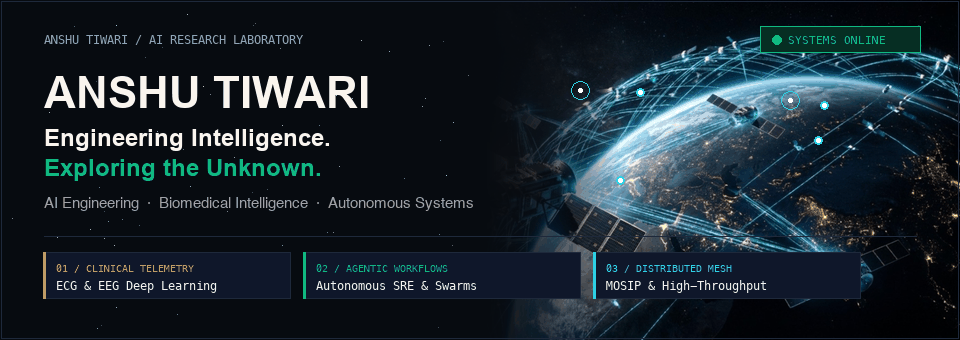
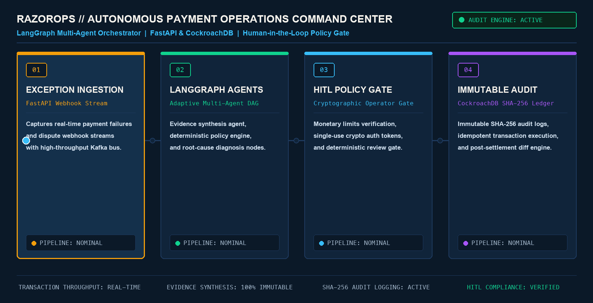
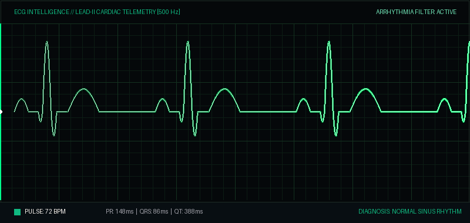
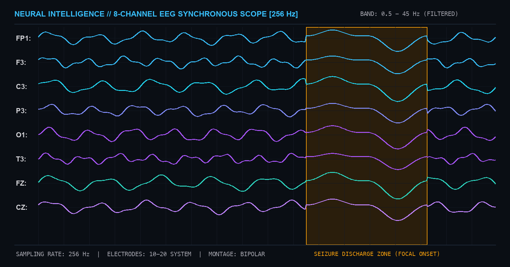
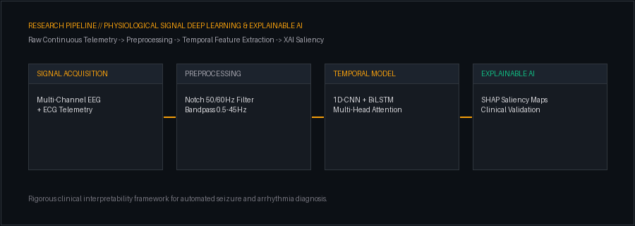
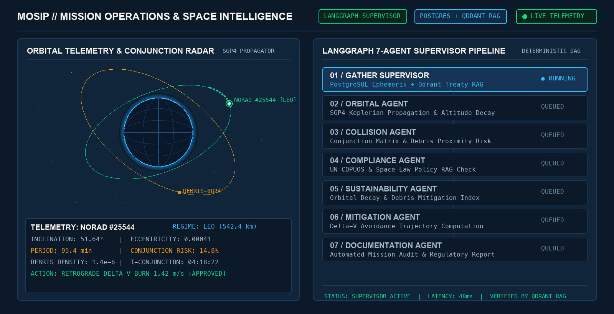

<div align="center">

<!-- 01: CINEMATIC DYNAMIC HERO BANNER -->
<a href="https://github.com/anshu-ai-arch">
  
</a>

<br/><br/>

<!-- Real-Time Terminal Status -->
<a href="https://github.com/anshu-ai-arch">
  
</a>

<br/>

<!-- Connected Social Navigation Bar -->
<p align="center">
  <a href="https://www.linkedin.com/in/anshu-tiwari-69b3b1327" target="_blank">
    
  </a>
  &nbsp;&nbsp;
  <a href="https://x.com/Anshutiwarai" target="_blank">
    
  </a>
  &nbsp;&nbsp;
  <a href="https://substack.com/@anshutiwari523410" target="_blank">
    
  </a>
  &nbsp;&nbsp;
  <a href="https://github.com/anshu-ai-arch?tab=repositories">
    
  </a>
</p>

</div>

<br/>

<!-- ========================================================================= -->
<!-- 02: IDENTITY & CORE RESEARCH PILLARS (LARGE COMMANDING TYPOGRAPHY)       -->
<!-- ========================================================================= -->

# 02 / IDENTITY &amp; CORE FOCUS

<table width="100%">
  <tr>
    <td style="padding: 24px; background: #161B22; border: 2px solid #30363D; border-radius: 10px;">
      <h2 style="margin: 0 0 14px 0; color: #FAF5EE; font-size: 26px;">
        ANSHU TIWARI &mdash; <span style="color: #10B981;">AI Systems Engineer &amp; Deep Learning Researcher in Biosignals</span>
      </h2>
      <p style="font-size: 17px; line-height: 1.6; color: #F4F4F5; margin: 0 0 20px 0;">
        Architect of <b>RazorOps</b> (Autonomous Payment Operations Command Center with LangGraph &amp; CockroachDB) and <b>MOSIP</b> (Mission Operations &amp; Space Intelligence Platform with LangGraph &amp; Qdrant RAG), and researcher in <b>deep learning for physiological biosignals</b> (clinical ECG cardiac telemetry &amp; 8-lead EEG neural decoding with Explainable AI).
      </p>
      <hr style="border: 0; border-top: 1.5px solid #30363D; margin: 18px 0;" />
      <table width="100%" style="font-size: 15px; border: none;">
        <tr>
          <td width="33%" valign="top" style="border: none; padding-right: 16px;">
            <span style="color: #10B981; font-weight: 800; font-family: monospace; font-size: 13px;">01 // AUTONOMOUS AI SYSTEMS</span><br/>
            <b style="color: #FAF5EE; font-size: 18px;">RazorOps &amp; MOSIP</b><br/>
            <span style="color: #D4D4D8; font-size: 14px; line-height: 1.5;">LangGraph supervisor architectures, real-time event ingestion, Human-in-the-Loop policy verification, and immutable SHA-256 audit ledgers.</span>
          </td>
          <td width="33%" valign="top" style="border: none; padding-right: 16px;">
            <span style="color: #F59E0B; font-weight: 800; font-family: monospace; font-size: 13px;">02 // BIOSIGNAL INTELLIGENCE</span><br/>
            <b style="color: #FAF5EE; font-size: 18px;">ECG &amp; EEG Deep Learning</b><br/>
            <span style="color: #D4D4D8; font-size: 14px; line-height: 1.5;">Automated epileptic seizure onset detection, continuous 8-lead neural telemetry, and P-QRS-T cardiac arrhythmia classification.</span>
          </td>
          <td width="33%" valign="top" style="border: none;">
            <span style="color: #38BDF8; font-weight: 800; font-family: monospace; font-size: 13px;">03 // MODEL INTERPRETABILITY</span><br/>
            <b style="color: #FAF5EE; font-size: 18px;">Explainable AI (XAI)</b><br/>
            <span style="color: #D4D4D8; font-size: 14px; line-height: 1.5;">Transformer attention head probing, residual stream activations, SHAP saliency maps, and clinical validation.</span>
          </td>
        </tr>
      </table>
    </td>
  </tr>
</table>

<br/>

<!-- ========================================================================= -->
<!-- 03: RAZOROPS — AUTONOMOUS PAYMENT OPERATIONS COMMAND CENTER               -->
<!-- ========================================================================= -->

# 03 / RAZOROPS &mdash; AUTONOMOUS PAYMENT OPERATIONS ARCHITECTURE

<p align="center">
  <a href="https://github.com/anshu-ai-arch/razorops">
    
  </a>
</p>

<table width="100%">
  <tr>
    <td width="25%" valign="top" style="padding: 12px; background: #161B22; border: 1px solid #30363D;">
      <b style="color: #F59E0B; font-size: 15px;">Stage 01: Ingestion</b><br/>
      <span style="color: #D4D4D8; font-size: 13.5px;">FastAPI webhook stream capturing payment failures and transaction exceptions in real time.</span>
    </td>
    <td width="25%" valign="top" style="padding: 12px; background: #161B22; border: 1px solid #30363D;">
      <b style="color: #10B981; font-size: 15px;">Stage 02: LangGraph</b><br/>
      <span style="color: #D4D4D8; font-size: 13.5px;">Multi-agent orchestration with adaptive tool selection and deterministic root-cause diagnosis.</span>
    </td>
    <td width="25%" valign="top" style="padding: 12px; background: #161B22; border: 1px solid #30363D;">
      <b style="color: #38BDF8; font-size: 15px;">Stage 03: HITL Policy</b><br/>
      <span style="color: #D4D4D8; font-size: 13.5px;">Monetary limit verification with single-use cryptographic authorization tokens for human review.</span>
    </td>
    <td width="25%" valign="top" style="padding: 12px; background: #161B22; border: 1px solid #30363D;">
      <b style="color: #A855F7; font-size: 15px;">Stage 04: Audit</b><br/>
      <span style="color: #D4D4D8; font-size: 13.5px;">CockroachDB immutable SHA-256 audit ledger with idempotent settlement and outbox pattern.</span>
    </td>
  </tr>
</table>

<br/>

<!-- ========================================================================= -->
<!-- 04: BIOSIGNAL DEEP LEARNING & NEURAL TELEMETRY (LIVE MONITORS)            -->
<!-- ========================================================================= -->

# 04 / BIOSIGNAL DEEP LEARNING &amp; NEURAL TELEMETRY

<table width="100%">
  <tr>
    <td width="50%" align="center" valign="top">
      <h3 style="font-size: 18px; color: #10B981;">ECG CARDIAC TELEMETRY // LIVE SIGNAL</h3>
      
      <p align="left" style="font-size: 14px; color: #E4E4E7;">
        <b>Model:</b> 1D-CNN + BiLSTM &bull; <b>Lead:</b> Lead-II Diagnostic (500 Hz)<br/>
        <b>Focus:</b> Real-time P-QRS-T arrhythmia detection, heart-rate variability, and clinical telemetry.
      </p>
    </td>
    <td width="50%" align="center" valign="top">
      <h3 style="font-size: 18px; color: #38BDF8;">EEG NEURAL ACTIVITY // 8-CHANNEL SCOPE</h3>
      
      <p align="left" style="font-size: 14px; color: #E4E4E7;">
        <b>Channels:</b> FP1, F3, C3, P3, O1, T3, FZ, CZ (256 Hz)<br/>
        <b>Focus:</b> Multi-channel rhythmic brainwave oscillations and highlighted focal seizure onset detection.
      </p>
    </td>
  </tr>
</table>

<p align="center">
  
</p>

<br/>

<!-- ========================================================================= -->
<!-- 05: MOSIP — MISSION OPERATIONS & SPACE INTELLIGENCE PLATFORM              -->
<!-- ========================================================================= -->

# 05 / MOSIP &mdash; MISSION OPERATIONS &amp; SPACE INTELLIGENCE PLATFORM

<p align="center">
  <a href="https://github.com/anshu-ai-arch/MOSIP1">
    
  </a>
</p>

<table width="100%">
  <tr>
    <td width="25%" valign="top" style="padding: 12px; background: #161B22; border: 1px solid #30363D;">
      <b style="color: #38BDF8; font-size: 15px;">Stage 01: Ingestion &amp; SGP4</b><br/>
      <span style="color: #D4D4D8; font-size: 13.5px;">PostgreSQL satellite ephemeris ingestion, SGP4 Keplerian orbital propagation, and altitude decay tracking across LEO/MEO/GEO regimes.</span>
    </td>
    <td width="25%" valign="top" style="padding: 12px; background: #161B22; border: 1px solid #30363D;">
      <b style="color: #F59E0B; font-size: 15px;">Stage 02: Conjunction Radar</b><br/>
      <span style="color: #D4D4D8; font-size: 13.5px;">Debris density modeling, close-encounter miss distance vectors, and automated collision probability scoring (0&ndash;100).</span>
    </td>
    <td width="25%" valign="top" style="padding: 12px; background: #161B22; border: 1px solid #30363D;">
      <b style="color: #A855F7; font-size: 15px;">Stage 03: Treaty RAG</b><br/>
      <span style="color: #D4D4D8; font-size: 13.5px;">Qdrant vector retrieval over UN COPUOS space treaties, FCC orbital debris guidelines, and international sustainability constraints.</span>
    </td>
    <td width="25%" valign="top" style="padding: 12px; background: #161B22; border: 1px solid #30363D;">
      <b style="color: #10B981; font-size: 15px;">Stage 04: Autonomous Evasion</b><br/>
      <span style="color: #D4D4D8; font-size: 13.5px;">Optimal Delta-V burn trajectory computation, collision mitigation planning, and automated mission incident audit logging.</span>
    </td>
  </tr>
</table>

<br/>

<!-- ========================================================================= -->
<!-- 06: FEATURED TECHNICAL REPOSITORIES                                       -->
<!-- ========================================================================= -->

# 06 / FEATURED TECHNICAL REPOSITORIES

<table width="100%">
  <tr>
    <td width="50%" valign="top">
      <h3 style="margin: 0 0 8px 0;"><a href="https://github.com/anshu-ai-arch/razorops" style="color: #10B981; font-size: 18px;">razorops</a></h3>
      <p style="font-size: 14.5px; color: #E4E4E7; line-height: 1.5;">Autonomous payment operations command center &mdash; LangGraph multi-agent orchestrator, CockroachDB SHA-256 audit ledger, Next.js telemetry.</p>
      <code>LangGraph</code> &bull; <code>FastAPI</code> &bull; <code>CockroachDB</code> &bull; <code>Next.js</code>
    </td>
    <td width="50%" valign="top">
      <h3 style="margin: 0 0 8px 0;"><a href="https://github.com/anshu-ai-arch/MOSIP1" style="color: #38BDF8; font-size: 18px;">MOSIP1</a></h3>
      <p style="font-size: 14.5px; color: #E4E4E7; line-height: 1.5;">Autonomous LangGraph multi-agent orbital intelligence, satellite conjunction analysis, Qdrant regulatory RAG, and collision avoidance maneuvers.</p>
      <code>LangGraph</code> &bull; <code>FastAPI</code> &bull; <code>PostgreSQL</code> &bull; <code>Qdrant</code>
    </td>
  </tr>
  <tr>
    <td width="50%" valign="top">
      <h3 style="margin: 0 0 8px 0;"><a href="https://github.com/anshu-ai-arch/eeg_seizure_detection" style="color: #F59E0B; font-size: 18px;">eeg_seizure_detection</a></h3>
      <p style="font-size: 14.5px; color: #E4E4E7; line-height: 1.5;">Deep learning models for automated epileptic seizure detection from continuous multi-channel biological EEG telemetry.</p>
      <code>Deep Learning</code> &bull; <code>Biosignals</code> &bull; <code>PyTorch</code> &bull; <code>EEG</code>
    </td>
    <td width="50%" valign="top">
      <h3 style="margin: 0 0 8px 0;"><a href="https://github.com/anshu-ai-arch/gpt2_interpretability_research" style="color: #A855F7; font-size: 18px;">gpt2_interpretability_research</a></h3>
      <p style="font-size: 14.5px; color: #E4E4E7; line-height: 1.5;">Mechanistic interpretability research on GPT-2 transformers &mdash; probing attention heads, residual streams, and neural activation paths.</p>
      <code>XAI</code> &bull; <code>Transformers</code> &bull; <code>PyTorch</code> &bull; <code>Interpretability</code>
    </td>
  </tr>
  <tr>
    <td width="50%" valign="top">
      <h3 style="margin: 0 0 8px 0;"><a href="https://github.com/anshu-ai-arch/cornflakes-copilot-" style="color: #FAF5EE; font-size: 18px;">cornflakes-copilot-</a></h3>
      <p style="font-size: 14.5px; color: #E4E4E7; line-height: 1.5;">Deterministic incident triage copilot &mdash; BM25 runbook RAG, chaos testing, policy verification, exactly-once delivery.</p>
      <code>AI Agents</code> &bull; <code>FastAPI</code> &bull; <code>Docker</code> &bull; <code>RAG</code>
    </td>
    <td width="50%" valign="top">
      <h3 style="margin: 0 0 8px 0;"><a href="https://github.com/anshu-ai-arch/hostalgrid-plus-plus" style="color: #FAF5EE; font-size: 18px;">hostalgrid-plus-plus</a></h3>
      <p style="font-size: 14.5px; color: #E4E4E7; line-height: 1.5;">Computational resource allocation modeling and grid optimization algorithms for high-throughput computing.</p>
      <code>Optimization</code> &bull; <code>Algorithms</code> &bull; <code>Jupyter</code> &bull; <code>HPC</code>
    </td>
  </tr>
</table>

<br/>

<!-- ========================================================================= -->
<!-- 07: PRODUCTION TOOLCHAIN & RESEARCH ARSENAL                               -->
<!-- ========================================================================= -->

# 07 / PRODUCTION TOOLCHAIN &amp; VERIFIED STACK

<div align="center">

```text
AI Systems & Orchestration: LangGraph · FastAPI · CockroachDB · Docker · PostgreSQL · Qdrant · Next.js · Linux
Deep Learning & Biosignals: PyTorch · Transformers · NumPy · SciPy · Scikit-Learn · Explainable AI (SHAP / Attention)
Tooling & Infrastructure:   Git · GitHub Actions CI/CD · Bash · Jupyter · Vector Stores · Prometheus
```


</div>

<br/>

<!-- ========================================================================= -->
<!-- 08: RESEARCH PUBLICATIONS & ESSAYS                                        -->
<!-- ========================================================================= -->

# 08 / RESEARCH PUBLICATIONS &amp; ESSAYS

<p align="center">
  <a href="https://substack.com/@anshutiwari523410" target="_blank">
    
  </a>
</p>

<br/>

<!-- PROFILE FOOTER -->
<div align="center">
  <p style="color: #A1A1AA; font-size: 15px; font-family: ui-monospace, monospace;">
    <b>Building, researching, and learning &mdash; one system at a time.</b>
  </p>
  <sub style="color: #71717A; font-family: ui-monospace, monospace; font-size: 12px;">Anshu Tiwari &bull; 2026</sub>
</div>
