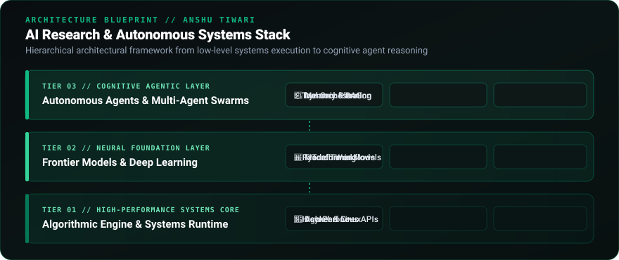
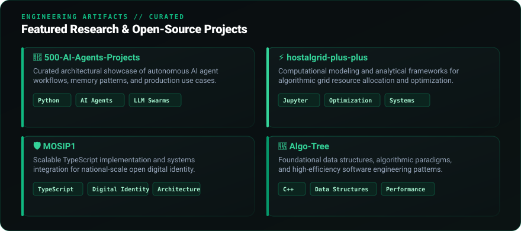
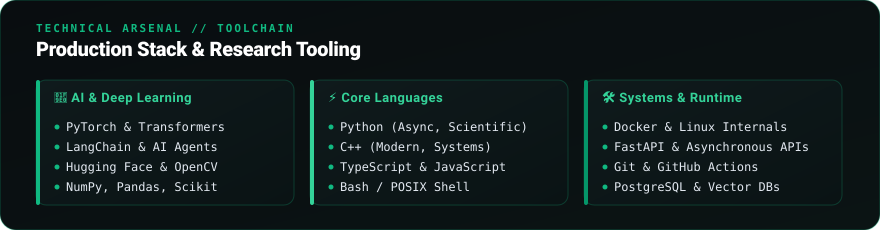

<!-- ZONE 01: HERO COMMAND CENTER -->

 

<!-- Dynamic Terminal Tagline -->

<!-- Integrated Social Navigation (Dark & Restrained, Zero Emojis) -->

  
  &nbsp;
  
  &nbsp;
  
  &nbsp;
  

 

<!-- ZONE 02: IDENTITY & SCIENTIFIC TELEMETRY (ECG/EEG WAVEFORM) -->

  

 

<!-- ZONE 03: DUAL-DOMAIN AI ARCHITECTURE SPECIFICATION -->

  

 

<!-- ZONE 04: SELECTED FLAGSHIP PRODUCTION WORK (6 ELITE REPOSITORIES) -->

  

  <a href="https://github.com/anshu-ai-arch/eeg_seizure_detection"><b>eeg_seizure_detection</b></a> &bull;
  <a href="https://github.com/anshu-ai-arch/cornflakes-copilot-"><b>cornflakes-copilot-</b></a> &bull;
  <a href="https://github.com/anshu-ai-arch/gpt2_interpretability_research"><b>gpt2_interpretability_research</b></a> &bull;
  <a href="https://github.com/anshu-ai-arch/hostalgrid-plus-plus"><b>hostalgrid-plus-plus</b></a> &bull;
  <a href="https://github.com/anshu-ai-arch/MOSIP1"><b>MOSIP1</b></a> &bull;
  <a href="https://github.com/anshu-ai-arch/razorops"><b>razorops</b></a>

 

<!-- ZONE 05: PRODUCTION TOOLCHAIN & RESEARCH ARSENAL -->

  

  

 

<!-- ZONE 06: TECHNICAL PUBLICATIONS & RESEARCH ESSAYS -->

  

 

<!-- ZONE 07: VERIFIABLE GITHUB ACTIVITY METRICS -->

  

 

<!-- PROFILE FOOTER -->

  

    <i>Building, researching, and learning &mdash; one system at a time.</i>
  

  Anshu Tiwari &bull; 2026

