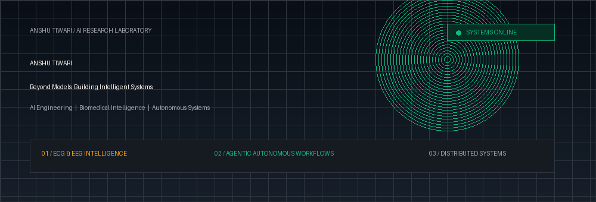

<div align="center">

<!-- 01: CINEMATIC RESEARCH LAB HERO BANNER -->


<br/>

<!-- Real-Time Terminal Status -->
<a href="https://github.com/anshu-ai-arch">
  
</a>

<!-- Navigation Bar (Restrained Flat Badges, Zero Emojis) -->
<p align="center">
  <a href="https://www.linkedin.com/in/anshu-tiwari-69b3b1327" target="_blank">
    
  </a>
  &nbsp;
  <a href="https://x.com/Anshutiwarai" target="_blank">
    
  </a>
  &nbsp;
  <a href="https://substack.com/@anshutiwari523410" target="_blank">
    
  </a>
  &nbsp;
  <a href="https://github.com/anshu-ai-arch?tab=repositories">
    
  </a>
</p>

</div>

---

### 02 / IDENTITY &amp; CORE FOCUS

```yaml
Researcher: Anshu Tiwari
Specialization: Biomedical Deep Learning, Model Interpretability & Autonomous AI
Clinical Focus: ECG Cardiac Telemetry & Multi-Lead EEG Signal Decoding
Systems Focus: Deterministic Agent Orchestration, SRE Copilots, High-Throughput APIs
Publications: Technical Analyses on Model Internals (substack.com/@anshutiwari523410)
```

- **Biomedical Intelligence:** Applying deep neural networks to physiological time-series signals (ECG &amp; EEG), focusing on automated seizure onset detection and cardiac telemetry.
- **Explainable AI (XAI):** Probing black-box models using attention maps, SHAP, and activation saliency to enable clinical interpretability and transformer mechanistic analysis.
- **Autonomous Systems:** Architecting resilient, deterministic multi-agent swarms with bounded tools, policy-as-code verification, and exactly-once execution pipelines.

---

### 03 / BIOMEDICAL SIGNAL RESEARCH &amp; TELEMETRY

<table width="100%">
  <tr>
    <td width="50%" align="center" valign="top">
      <h4>ECG CARDIAC TELEMETRY // LIVE SIGNAL</h4>
      
      <p align="left">
        <sub><b>Model:</b> 1D-CNN + BiLSTM &bull; <b>Lead:</b> Lead-II Diagnostic (500 Hz)<br/>
        <b>Focus:</b> Real-time QRS arrhythmia detection and morphological classification.</sub>
      </p>
    </td>
    <td width="50%" align="center" valign="top">
      <h4>EEG NEURAL ACTIVITY // 8-CHANNEL SCOPE</h4>
      
      <p align="left">
        <sub><b>Channels:</b> CP6, F6, C4, CP4, CP3, F5, C3, CP5 (256 Hz)<br/>
        <b>Focus:</b> Multi-channel rhythmic brainwave oscillations and seizure spike decoding.</sub>
      </p>
    </td>
  </tr>
</table>

<p align="center">
  
</p>

---

### 04 / AUTONOMOUS SYSTEMS &amp; DISTRIBUTED ARCHITECTURE

<p align="center">
  <h4>MOSIP DISTRIBUTED ARCHITECTURE // CONSTELLATION TELEMETRY</h4>
  
</p>

<p align="center">
  
</p>

---

### 05 / FEATURED TECHNICAL REPOSITORIES

<table>
  <tr>
    <td width="50%" valign="top">
      <h4><a href="https://github.com/anshu-ai-arch/eeg_seizure_detection">eeg_seizure_detection</a></h4>
      <p>Deep learning models for automated epileptic seizure detection from continuous multi-channel biological EEG telemetry.</p>
      <code>Python</code> &bull; <code>EEG</code> &bull; <code>Deep Learning</code> &bull; <code>PyTorch</code>
    </td>
    <td width="50%" valign="top">
      <h4><a href="https://github.com/anshu-ai-arch/cornflakes-copilot-">cornflakes-copilot-</a></h4>
      <p>Autonomous SRE and incident triage copilot — deterministic tool execution, BM25 runbook RAG, chaos tests, exactly-once pipelines.</p>
      <code>AI Agents</code> &bull; <code>FastAPI</code> &bull; <code>PostgreSQL</code> &bull; <code>Docker</code>
    </td>
  </tr>
  <tr>
    <td width="50%" valign="top">
      <h4><a href="https://github.com/anshu-ai-arch/gpt2_interpretability_research">gpt2_interpretability_research</a></h4>
      <p>Mechanistic interpretability research on GPT-2 transformers — probing attention heads, residual streams, and neural activation paths.</p>
      <code>XAI</code> &bull; <code>Transformers</code> &bull; <code>PyTorch</code> &bull; <code>Interpretability</code>
    </td>
    <td width="50%" valign="top">
      <h4><a href="https://github.com/anshu-ai-arch/hostalgrid-plus-plus">hostalgrid-plus-plus</a></h4>
      <p>Computational resource allocation modeling and grid optimization algorithms for high-throughput computing.</p>
      <code>Optimization</code> &bull; <code>Algorithms</code> &bull; <code>Jupyter</code> &bull; <code>HPC</code>
    </td>
  </tr>
  <tr>
    <td width="50%" valign="top">
      <h4><a href="https://github.com/anshu-ai-arch/MOSIP1">MOSIP1</a></h4>
      <p>Scalable TypeScript integration for national-scale open digital identity architecture and modular services.</p>
      <code>TypeScript</code> &bull; <code>Distributed Systems</code> &bull; <code>Identity</code>
    </td>
    <td width="50%" valign="top">
      <h4><a href="https://github.com/anshu-ai-arch/razorops">razorops</a></h4>
      <p>Production-grade automated CI/CD pipeline infrastructure, containerized build environments, and delivery acceleration.</p>
      <code>CI/CD</code> &bull; <code>Docker</code> &bull; <code>DevOps</code> &bull; <code>Linux</code>
    </td>
  </tr>
</table>

---

### 06 / PRODUCTION TOOLCHAIN &amp; VERIFIED STACK

<div align="center">

```text
Research:    PyTorch · Transformers · NumPy · SciPy · Scikit-Learn · Explainable AI (SHAP / Attention)
Engineering: Python (Async) · Modern C++ (17/20) · TypeScript · FastAPI · Docker · PostgreSQL · Linux
Tooling:     Git · GitHub Actions CI/CD · Bash · Jupyter · Vector Stores
```


</div>

---

### 07 / RESEARCH PUBLICATIONS &amp; ESSAYS

<p align="center">
  <a href="https://substack.com/@anshutiwari523410" target="_blank">
    
  </a>
</p>

---

<div align="center">
  <p style="color: #A1A1AA; font-size: 13px; font-family: ui-monospace, monospace;">
    <i>Building, researching, and learning &mdash; one system at a time.</i>
  </p>
  <sub style="color: #52525B; font-family: ui-monospace, monospace;">Anshu Tiwari &bull; 2026</sub>
</div>
